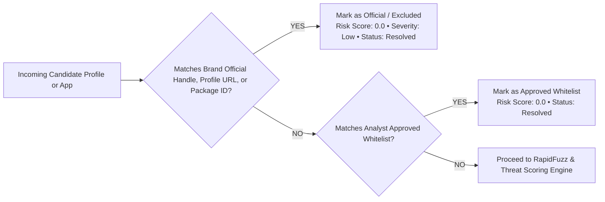
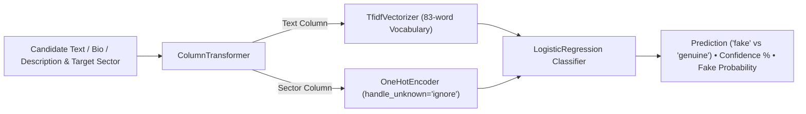

# SentinelX — System Architecture & Design Specification

> **Tagline:** One Platform. Five Sectors. Smarter Digital Protection.

---

## 1. High-Level Architecture Overview

SentinelX is engineered as a unified multi-sector digital risk protection platform. Rather than siloed, sector-specific applications, SentinelX runs on a single **shared detection engine** coupled with dynamic **sector configurations** and **identity fingerprints**.

### End-to-End Architectural Data Flow

```mermaid
flowchart TD
    subgraph UI["React + TypeScript Responsive Frontend"]
        OD[Global Overview Dashboard]
        SD[Sector-Specific Dashboards (5+ Domains)]
        BP[Brand Identity Fingerprint & Asset Registry]
        SM[Social Threat Monitor]
        AM[App Store Threat Monitor]
        TG[Threat Intelligence Graph]
        IQ[Investigation Queue & Case Dossiers]
    end

    subgraph API["FastAPI REST API Layer (Python 3.12)"]
        Router[API Routers: /sectors, /brands, /social, /apps, /findings, /threat-graph, /sources]
        Validation[Pydantic V2 Request & Response Schemas]
    end

    subgraph ENGINE["Shared Detection & Risk Engine"]
        Normalizer[Text & Handle Normalizer (Leetspeak / Homoglyphs)]
        ExclusionEngine["Official Asset & Whitelist Exclusion (Mandatory Filter)"]
        SimilarityEngine["RapidFuzz Fuzzy Matcher & TF-IDF Cosine Similarity"]
        SectorRules["Sector Config & Threat Category Rules Evaluator"]
        Scorer["Heuristic Risk Scorer & Severity Bander (Low/Med/High/Crit)"]
        GraphEngine[Threat Intelligence Correlation Engine]
    end

    subgraph DB["Storage & Persistence"]
        ORM[SQLAlchemy ORM 2.0]
        SQLite[(SQLite Persistent Database: sentinelx.db)]
    end

    UI -->|REST / JSON| Router
    Router --> Validation
    Validation --> ENGINE
    ExclusionEngine -->|Exact Match -> Risk 0.0 Excluded| ORM
    SimilarityEngine --> SectorRules
    SectorRules --> Scorer
    Scorer --> GraphEngine
    GraphEngine --> ORM
    ORM --> SQLite
```

---

## 2. Multi-Sector Core Concept: One Engine, Dynamic Profiles

The core architecture operates on a **Config-Driven Domain Pattern**:
All 5 sectors share the exact same database models, detection pipeline, and UI layout:

1. **Banking & FinTech:** Targets bank lookalikes, predatory loan APKs, payment clones, fake customer care handles.
2. **E-commerce & Online Shopping:** Targets cloned storefronts, counterfeit merchants, flash sale bait, unauthorized apps.
3. **Education & Universities:** Targets fake admission desks, unauthorized fee-payment portals, scholarship scams.
4. **Telecom & Mobile Networks:** Targets fake recharge apps, customer support impersonation, SIM swap and 5G data lures.
5. **Government Digital Services:** Targets fake citizen welfare portals (Yojana schemes), identity document phishers.
6. **Custom Sectors:** Dynamically created via `Custom Sector Builder` (e.g. Healthcare, Aviation) and instantly integrated.

---

## 3. False-Positive Control & Mandatory Official Asset Exclusion

To avoid alert fatigue and inaccurate risk scoring, SentinelX enforces a strict **Pre-Detection Exclusion Barrier**:



### Heuristic Scoring Formula

Risk score is computed through transparent, normalized weights:

$$\text{Risk Score} = \frac{\sum (\text{Signal Score}_i \times \text{Weight}_i)}{\sum \text{Present Weights}} \times 100$$

* **Name Similarity (35%):** Fuzzy ratio, token sort, and containment against registered trademarks and aliases.
* **Publisher / Developer Verification (25%):** Exact match vs deviation from official legal publisher.
* **Package Identifier Analysis (20%):** Mimicked bundle IDs (e.g. `com.apexloans.instantcash`).
* **Sector Threat Bait (20%):** Detection of sector-specific bait terms (e.g. "instant loan", "refund helpline", "subsidy grant").

Missing metadata is strictly marked as unknown, never penalized as an indicator of compromise.

---

## 4. Threat Intelligence Graph Model

The Threat Intelligence Graph correlates entities across multiple domains based on hard evidence:

* **Nodes:**
  * `Brand`: Registered protected entities.
  * `Social`: Candidate profiles across Twitter, Instagram, Telegram, etc.
  * `App`: Mobile APKs from Google Play, App Store, APK Pure.
  * `Publisher`: Developer legal names.
  * `Domain`: Registered web hosts and URLs.
* **Edges:**
  * `POTENTIAL_IMPERSONATION`
  * `UNAUTHORIZED_CLONE`
  * `PUBLISHER_MISMATCH`
  * `VERIFIED_OFFICIAL_ACCOUNT`
  * `OFFICIAL_DOMAIN`

---

## 5. Machine Learning NLP Classifier (`fake_detection_model.pkl`)

To complement fuzzy string distances and heuristic weights, SentinelX integrates a serialized **scikit-learn NLP Pipeline**:



* **Storage & Loading:** Loaded as a singleton via `joblib.load()` from `backend/fake_detection_model.pkl`.
* **Endpoints:** Exposed through dedicated `POST /api/detection/predict` and surfaced in candidate monitoring tables as `🤖 FAKE (XX%)` badges.

---

## 6. Look-Alike Name Detection (Bonus Feature)

The normalization pipeline (`app/services/normalizer.py` & `app/services/similarity.py`) detects evasive naming tricks without flagging normal words:

1. **Character Swaps & Homoglyphs:** Leetspeak replacements (e.g. `0` $\leftrightarrow$ `o`, `1` $\leftrightarrow$ `l`/`i`, `@` $\leftrightarrow$ `a`, `$` $\leftrightarrow$ `s`).
2. **Spacing Changes & Punctuation Stripping:** Punctuation removal and slug tokenization (e.g. `apex-bank` vs `apex bank` vs `apexbank`).
3. **Added Words & Containment:** RapidFuzz `token_set_ratio` isolates brand stems even when padded with keywords like `official`, `support`, `24x7`, `helpline`, `instantloans`.
4. **Official Exclusion Barrier:** Ensures legitimate brand variations registered in Brand Profiles (e.g. `@ApexBankOfficial`) receive a 0.0 risk score and are never over-flagged.
